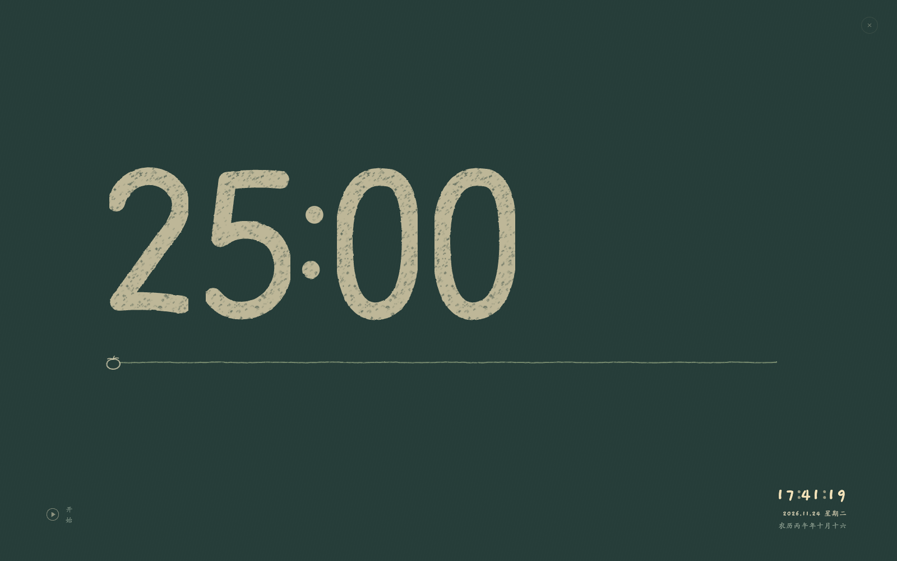

# 番茄时钟

一块常驻屏幕的极简番茄钟。手绘质感，不弹窗、不提醒、不催你，专注时随手敲的一句话会自动落进你的笔记库。



## 它解决什么

大多数番茄钟都在抢你的注意力：弹窗、声音、进度条、打断你摸一下手机。

这个不是。它把自己摊在屏幕上，安静到你可以忘掉它——然后余光扫一眼就知道还剩多久。开始和暂停只按一个组合键，或者点一下左下角。

三个设计前提：

- **屏幕上有它，但你不该看它。** 数字占屏高约四分之一，2–3 米外能读清，但不刺眼。
- **不打断。** 没有「时间到！」的弹窗，最后 3 分钟整块屏转成暖红，你自己会注意到。
- **想法不留白。** 想到什么按 `⌥⌘N` 敲一句，不用切窗口，段落结束时自动归档。

## 功能

- 手绘蜡笔风格：墨绿底、奶油色笔触，数字是 SVG 手写字形
- **进度番茄**：横线左端那棵番茄会随进度右移，同时兼任状态灯——空心=空闲、淡填=专注中、虚线=暂停、红空心=最后 3 分钟、红实心=完成
- **多屏**：自动挑最小的一块屏；`⌥⌘D` 手动换屏
- **两种形态**：全屏常驻 ↔ 名片大小（`⌥⌘F`），名片态可以拖到任何角落
- **鼠标穿透**：全屏时整块屏默认点得穿，不会挡住你下面的窗口。只有靠近退出圆点和开始按钮时才接管点击
- **让开**：`⌥⌘H` 一下把时钟收走，这片屏立刻变回普通桌面，要用 Dock、调度中心全都可以；再按一次回来，计时不停
- **记录**：每段结束写进当月 Markdown，带类别、时长和你敲的笔记
- **时间画像**：菜单里可以生成近 7 天 / 30 天的统计页

## 安装

### 直接下载

到 [Releases](../../releases) 下载最新 zip，解压后把 `番茄时钟.app` 拖进「应用程序」。

> **第一次打开会被系统拦下**，提示「已损坏，无法打开」或「无法验证开发者」。
> 这不是文件坏了——这个应用没有 Apple 开发者签名（那个要 99 美元/年）。
> 解决办法：**右键点图标 → 打开 → 再点一次「打开」**。只需要一次。
>
> 如果右键也不行，在终端运行：
> ```bash
> xattr -dr com.apple.quarantine /Applications/番茄时钟.app
> ```

**系统要求**：macOS 12 或更新，**Apple 芯片（M 系列）**。Intel Mac 暂未提供。

### 从源码跑

```bash
git clone <本仓库地址>
cd pomodoro
npm install
npm start
```

打包成 .app：

```bash
npm run dist        # 生成 dist/ 下的 dmg
```

## 快捷键

| 键 | 做什么 |
|---|---|
| `⌥⌘P` | 开始 / 暂停 / 继续（也可以点左下角的按钮） |
| `⌥⌘N` | 记一句（任何时刻都能按，不用先点哪里） |
| `⌥⌘K` | 作废这一段（不计入统计，也不记成失败） |
| `⌥⌘F` | 全屏常驻 ↔ 名片大小 |
| `⌥⌘D` | 把时钟挪到下一块屏 |
| `⌥⌘H` | 让开一会儿（退出全屏，把屏幕还给桌面） |
| `⌘Q` | 退出 |

菜单栏的番茄图标里还有：换屏、生成时间画像、打开记录文件夹、开机自启、提示音开关等。

## 记录落在哪

默认写到：

```
~/Documents/番茄时钟/记录/2026-11.md
```

每个月一个文件，同一天的多段会追加到同一天的小标题下。

**想接进自己的笔记库**（Obsidian、Logseq 等）：编辑配置文件里的 `recordDir`，或者启动前设置环境变量：

```bash
POMODORO_RECORD_DIR=~/Documents/我的笔记/番茄记录 npm start
```

配置文件位置：

- macOS：`~/Library/Application Support/番茄时钟/config.json`
- Windows：`%APPDATA%\番茄时钟\config.json`
- Linux：`~/.config/番茄时钟/config.json`

数据分两层：`data/events.jsonl` 是完整事件流（每次开始、结束、一句笔记都有一行），`记录/*.md` 是给人读的合并视图。两者对账，启动时会补写漏掉的段落。

## 设计取舍

有几个决定看起来像缺点，是故意的：

- **没有连续天数、没有徽章、没有排行榜。** 那类机制会把产品往「让人上瘾」优化，而这个东西的成功标准是「一周后你还在用，且不觉得被它管着」。
- **没有时长设置界面。** 改时长要动配置文件。因为全屏时钟上开一个输入框，就得临时接管键盘、取消穿透、管焦点、管 Esc——跟「一块安静的屏」正面冲突。
- **退出要点两下。** 右上角圆点第一次点是「上膛」，3 秒内再点一次才真退出。防手滑。
- **不主动提醒你休息。** 它记录，但不劝你。

## 已知限制

- 只编了 **arm64**（Apple 芯片），Intel Mac 和 Windows 需要另外构建
- **没有代码签名**，每次重新下载安装都要过一次 Gatekeeper
- Windows / Linux 上的代码路径已经处理了（数据目录按平台走），但窗口层级、鼠标穿透、全局快捷键这几处只按 macOS 调过，未验证
- 中文界面，没有做 i18n

## 开发

纯 Electron + 原生 HTML/CSS/JS，没有框架、没有构建步骤、不联网。

```
main.js            主进程：窗口、快捷键、菜单、计时状态机
preload.js         渲染进程与主进程的桥
lib/store.js       配置、事件流、Markdown 写回
lib/report.js      时间画像
renderer/          界面（index.html / styles.css / renderer.js）
tools/             测试与临时脚本
```

跑测试：

```bash
npm test              # 渲染层断言，不需要额外依赖
npm run test:native   # 端到端，需要 playwright
```

> 如果你的环境里存在 `ELECTRON_RUN_AS_NODE=1`（某些 Node 工具会设置），跑 Electron 测试前要临时去掉，否则 Electron 会被当成纯 Node 启动。

## License

MIT
